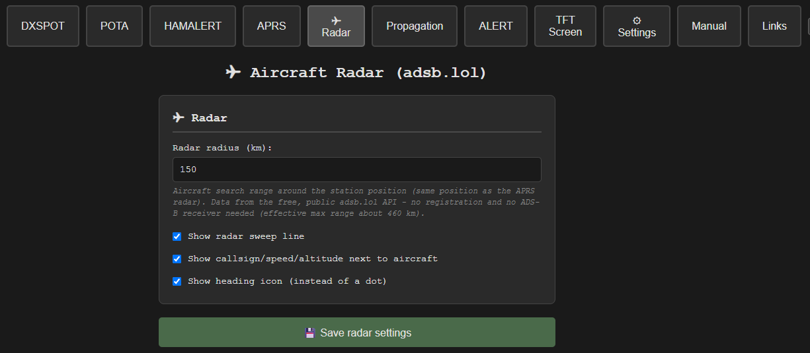
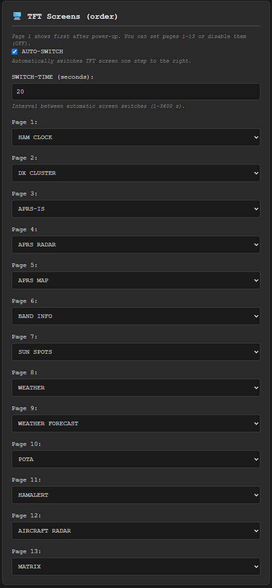
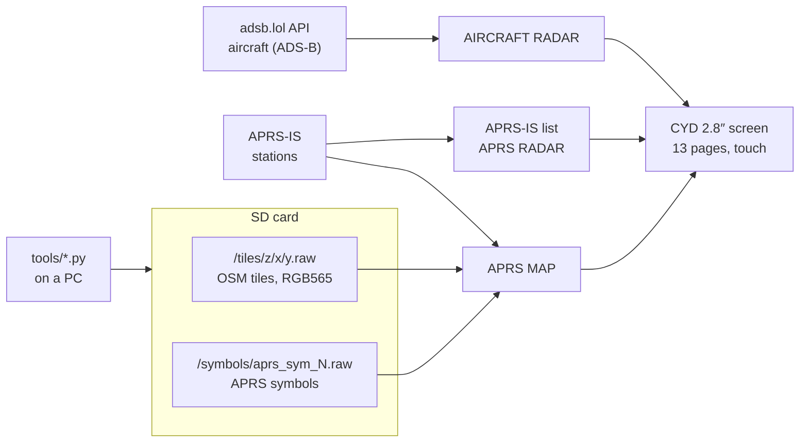

# ESP32 HAM CLOCK — aircraft radar and APRS map (SP9TKN fork)

> 🇵🇱 Polish version: [README.pl.md](README.pl.md) · The original project by SP3KON: [README.sp3kon.md](README.sp3kon.md)
> (Polish), [readmeEN.md](readmeEN.md) (English)

**[ESP32 HAM CLOCK](https://github.com/SP3KON/ESP32-HAM-CLOCK) by SP3KON is a ham-radio clock and DX/APRS terminal for
the ESP32 "Cheap Yellow Display" (ESP32-2432S028, 2.8" touch screen) with a web panel. This fork adds two screens: an
aircraft radar fed by the public adsb.lol API, and an APRS map drawn from OpenStreetMap tiles on the SD card, with the
real APRS symbols.** Everything else is SP3KON's v1.2.2. The screen labels can be English or Polish (*TFT UI
language*), and the web panel has both languages.

  
  
  

Screens of the original ESP32 HAM CLOCK — photos by SP3KON from his repository.

## What this fork adds

### Aircraft radar (page *AIRCRAFT RADAR*)

- Aircraft around your station from [adsb.lol](https://adsb.lol), free and public: no registration and no ADS-B
  receiver of your own. The radius is set in km in the web panel (the API allows up to 250 NM, about 460 km).
- Fresh data every 15 s; between fetches each aircraft keeps moving along its heading and speed.
- Options: the radar sweep line, callsign/speed/altitude labels, a heading icon instead of a dot.
- The centre is the station position, the same as for the APRS radar.

### APRS map (page *APRS MAP*)

- APRS-IS stations on a real map: OpenStreetMap tiles stored on the microSD card as raw RGB565
  (`/tiles/<zoom>/<x>/<y>.raw`), stations drawn with the standard APRS symbols (`/symbols/aprs_sym_0..2.raw`).
- Touch: drag to move the map; tap the upper part to zoom in and the lower part to zoom out (zoom 8–16).
- With PSRAM the map is drawn into a screen buffer; without it, straight from the card.

Preparing the card on a PC (Python 3 with Pillow), then copy `tiles/` and `symbols/` to the root of the FAT32 card:

| Script | What it does |
|---|---|
| `tools/convert_tiles.py --lat 50.06 --lon 19.94 --zoom 10 12 14 --radius 3 --out tiles` | downloads OSM tiles around a point and converts them; keep to the [OSM tile usage policy](https://operations.osmfoundation.org/policies/tiles/) and download only what you need |
| `tools/convert_local_tiles.py --src <folder> --out tiles` | converts PNG tiles you already have (`<zoom>/<x>/<y>.png`) |
| `tools/convert_aprs_symbols.py` | fetches the symbol sheets of [hessu/aprs-symbols](https://github.com/hessu/aprs-symbols) and writes `symbols/aprs_sym_N.raw` |

Map data © OpenStreetMap contributors (ODbL).

### APRS extras and the rest

- **Beacon places:** up to six named positions set in the web panel; the one the beacon uses is chosen on the touch
  screen (APRS → menu → Beaconing).
- Alert icons for station types (iGate, LoRa, WX, digipeater, repeater, bike, truck, ship) and small symbols in the
  APRS-IS list.
- **13 pages**, each one can be placed anywhere or switched off in the web panel.
- The reason of the last reset is kept in a log.
- `platformio.ini`: a partition table without OTA (more room for the program and the web panel) and PSRAM support.

## Web panel

  

  

The Radar page and the page order, taken from this fork's <code>data/</code> folder served by a
local test server (the settings shown are examples).

## Where the data come from

## Hardware

ESP32-2432S028 "CYD" (ILI9341 2.8" screen, XPT2046 touch) with a microSD card (CS on GPIO5, on the touch SPI bus).
PSRAM is optional.

## Flashing

**[Releases](../../releases)** hold the build from 2 Nov 2026 that runs on the author's device:

| File | Address | What |
|---|---|---|
| `esp32-ham-clock-radar_2026-11-02_flash_at_0x0.bin` | 0x0 | everything: bootloader, partitions, program, web panel — **clears the saved settings** (Wi-Fi and so on) |
| `esp32-ham-clock-radar_2026-11-02_app_at_0x10000.bin` | 0x10000 | only the program, keeps the settings |
| `esp32-ham-clock-radar_2026-11-02_littlefs_at_0x210000.bin` | 0x210000 | only the web panel |

`python -m esptool --chip esp32 --port COMx write_flash 0x0 esp32-ham-clock-radar_2026-11-02_flash_at_0x0.bin`.
Coming from another firmware, write the full image, because the partition table is different. To update this fork
and keep the settings: `write_flash 0x10000 <app file> 0x210000 <littlefs file>`.

From source with PlatformIO: `pio run -e esp32-2432s028 -t upload` and `pio run -e esp32-2432s028 -t uploadfs`. In the
release binary only the PlatformIO package paths of the build computer were replaced with a neutral one (same length,
checksum and SHA-256 recalculated).

## Related

- [cyd-monitor](https://github.com/SP9TKN/cyd-monitor) — the same CYD board as a wireless Windows monitor and SDR
  scanner display (SP9TKN).

## License

[MIT](LICENSE), like the original. Map data © OpenStreetMap contributors (ODbL); the APRS symbols come from
[hessu/aprs-symbols](https://github.com/hessu/aprs-symbols) (see that repository for their license).

**Tools:** developed with [Claude Code](https://claude.com/claude-code) (Anthropic) — AI assistant used for
coding, testing and documentation.
