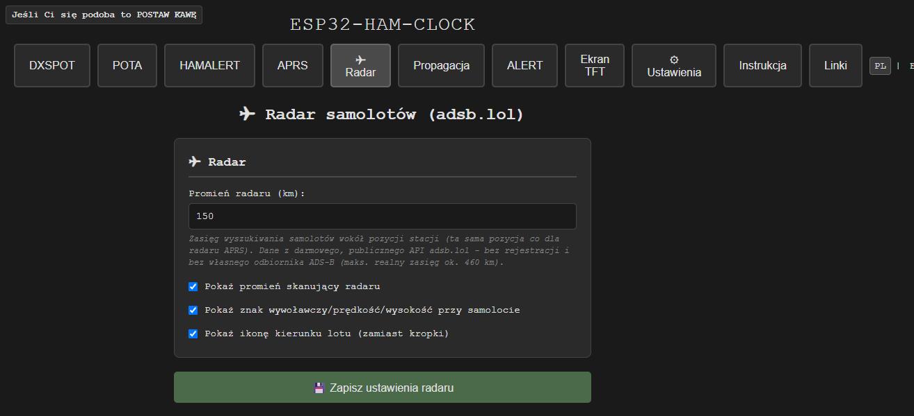
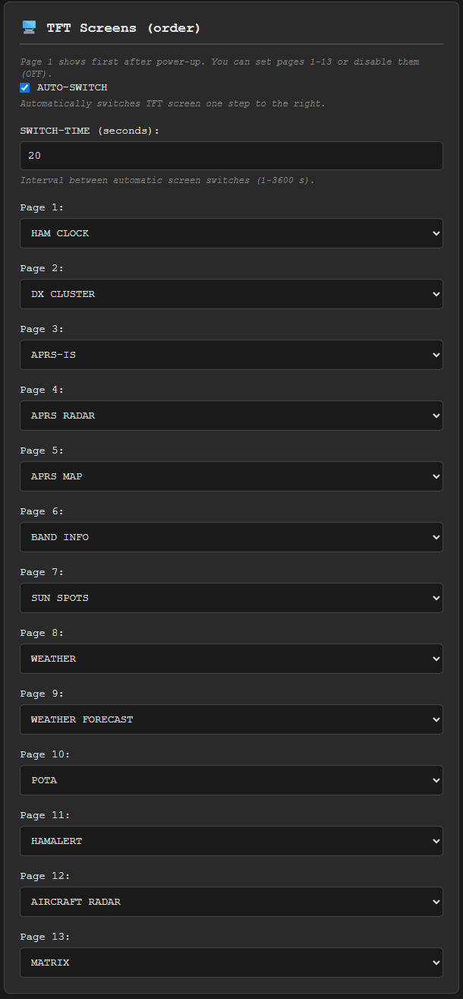
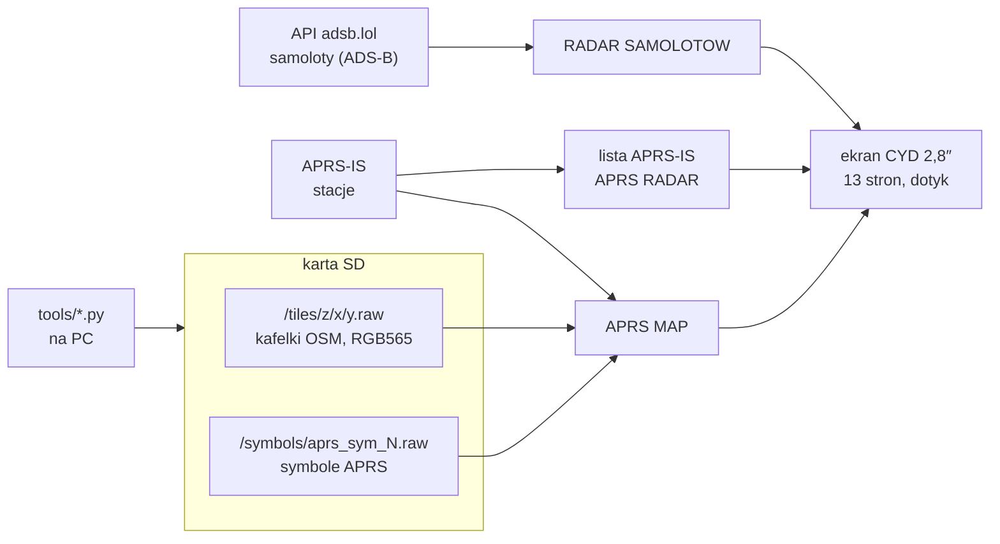

# ESP32 HAM CLOCK — radar samolotów i mapa APRS (fork SP9TKN)

> 🇬🇧 English version: [README.md](README.md) · Oryginalny projekt SP3KON: [README.sp3kon.md](README.sp3kon.md)

**[ESP32 HAM CLOCK](https://github.com/SP3KON/ESP32-HAM-CLOCK) autorstwa SP3KON to zegar krótkofalowca i terminal
DX/APRS dla ESP32 „Cheap Yellow Display” (ESP32-2432S028, ekran dotykowy 2,8") z panelem WWW. Ten fork dodaje dwa
ekrany: radar samolotów z publicznego API adsb.lol oraz mapę APRS rysowaną z kafelków OpenStreetMap na karcie SD,
z prawdziwymi symbolami APRS.** Cała reszta to wersja v1.2.2 od SP3KON. Napisy na ekranie mogą być po polsku albo
angielsku (*Język TFT*), a panel WWW ma oba języki.

  
  
  

Ekrany oryginalnego ESP32 HAM CLOCK — zdjęcia SP3KON z jego repozytorium.

## Co dodaje ten fork

### Radar samolotów (strona *RADAR SAMOLOTOW*)

- Samoloty wokół Twojej stacji z [adsb.lol](https://adsb.lol), darmowo i publicznie: bez rejestracji i bez własnego
  odbiornika ADS-B. Promień ustawiasz w km w panelu WWW (API pozwala do 250 NM, ok. 460 km).
- Świeże dane co 15 s; między pobraniami każdy samolot przesuwa się dalej wg kursu i prędkości.
- Opcje: linia skanowania radaru, opisy (znak, prędkość, wysokość), ikona kierunku zamiast kropki.
- Środek to pozycja stacji, ta sama co dla radaru APRS.

### Mapa APRS (strona *APRS MAP*)

- Stacje z APRS-IS na prawdziwej mapie: kafelki OpenStreetMap zapisane na karcie microSD jako surowe RGB565
  (`/tiles/<zoom>/<x>/<y>.raw`), stacje rysowane standardowymi symbolami APRS (`/symbols/aprs_sym_0..2.raw`).
- Dotyk: przeciągnięcie przesuwa mapę; stuknięcie w górną część przybliża, w dolną oddala (zoom 8–16).
- Z PSRAM mapa jest rysowana do bufora ekranu, bez PSRAM prosto z karty.

Przygotowanie karty na PC (Python 3 z Pillow), potem skopiuj `tiles/` i `symbols/` do katalogu głównego karty FAT32:

| Skrypt | Co robi |
|---|---|
| `tools/convert_tiles.py --lat 50.06 --lon 19.94 --zoom 10 12 14 --radius 3 --out tiles` | pobiera kafelki OSM wokół punktu i je przelicza; trzymaj się [zasad korzystania z kafelków OSM](https://operations.osmfoundation.org/policies/tiles/) i pobieraj tylko to, czego potrzebujesz |
| `tools/convert_local_tiles.py --src <folder> --out tiles` | przelicza kafelki PNG, które już masz (`<zoom>/<x>/<y>.png`) |
| `tools/convert_aprs_symbols.py` | pobiera arkusze symboli z [hessu/aprs-symbols](https://github.com/hessu/aprs-symbols) i zapisuje `symbols/aprs_sym_N.raw` |

Dane mapy © autorzy OpenStreetMap (ODbL).

### Dodatki APRS i reszta

- **Miejsca beaconu:** do sześciu nazwanych pozycji ustawianych w panelu WWW; to, z którego nadaje beacon, wybierasz na
  ekranie dotykowym (APRS → menu → Beaconing).
- Ikony alertów dla rodzajów stacji (iGate, LoRa, WX, digipeater, przemiennik, rower, ciężarówka, statek) i małe
  symbole na liście APRS-IS.
- **13 stron**, każdą można ustawić w dowolnym miejscu albo wyłączyć w panelu WWW.
- Przyczyna ostatniego restartu jest zapisywana w dzienniku.
- `platformio.ini`: tablica partycji bez OTA (więcej miejsca na program i panel WWW) i obsługa PSRAM.

## Panel WWW

  
  

Strona Radar i kolejność ekranów z folderu <code>data/</code> tego forka, podane przez lokalny
serwer testowy (ustawienia są przykładowe).

## Skąd biorą się dane

## Sprzęt

ESP32-2432S028 „CYD” (ekran ILI9341 2,8", dotyk XPT2046) z kartą microSD (CS na GPIO5, na magistrali SPI dotyku).
PSRAM jest opcjonalny.

## Wgrywanie

W **[Releases](../../releases)** jest kompilacja z 2.11.2026, która działa w urządzeniu autora:

| Plik | Adres | Co |
|---|---|---|
| `esp32-ham-clock-radar_2026-11-02_flash_at_0x0.bin` | 0x0 | całość: bootloader, partycje, program, panel WWW — **kasuje zapisane ustawienia** (Wi-Fi itd.) |
| `esp32-ham-clock-radar_2026-11-02_app_at_0x10000.bin` | 0x10000 | tylko program, ustawienia zostają |
| `esp32-ham-clock-radar_2026-11-02_littlefs_at_0x210000.bin` | 0x210000 | tylko panel WWW |

`python -m esptool --chip esp32 --port COMx write_flash 0x0 esp32-ham-clock-radar_2026-11-02_flash_at_0x0.bin`.
Przy przejściu z innego firmware'u wgraj pełny obraz, bo tablica partycji jest inna. Aktualizacja tego forka
z zachowaniem ustawień: `write_flash 0x10000 <plik app> 0x210000 <plik littlefs>`.

Ze źródeł przez PlatformIO: `pio run -e esp32-2432s028 -t upload` i `pio run -e esp32-2432s028 -t uploadfs`. W pliku
z wydania zmienione są tylko ścieżki pakietów PlatformIO z komputera, na którym powstał (ta sama długość, suma
kontrolna i SHA-256 przeliczone).

## Powiązane

- [cyd-monitor](https://github.com/SP9TKN/cyd-monitor) — ta sama płytka CYD jako bezprzewodowy monitor Windows
  i wyświetlacz skanera SDR (SP9TKN).

## Licencja

[MIT](LICENSE), jak oryginał. Dane mapy © autorzy OpenStreetMap (ODbL); symbole APRS pochodzą
z [hessu/aprs-symbols](https://github.com/hessu/aprs-symbols) (ich licencja w tamtym repozytorium).

**Narzędzia:** program powstał z pomocą [Claude Code](https://claude.com/claude-code) (Anthropic) — asystent AI
do pisania kodu, testów i dokumentacji.
